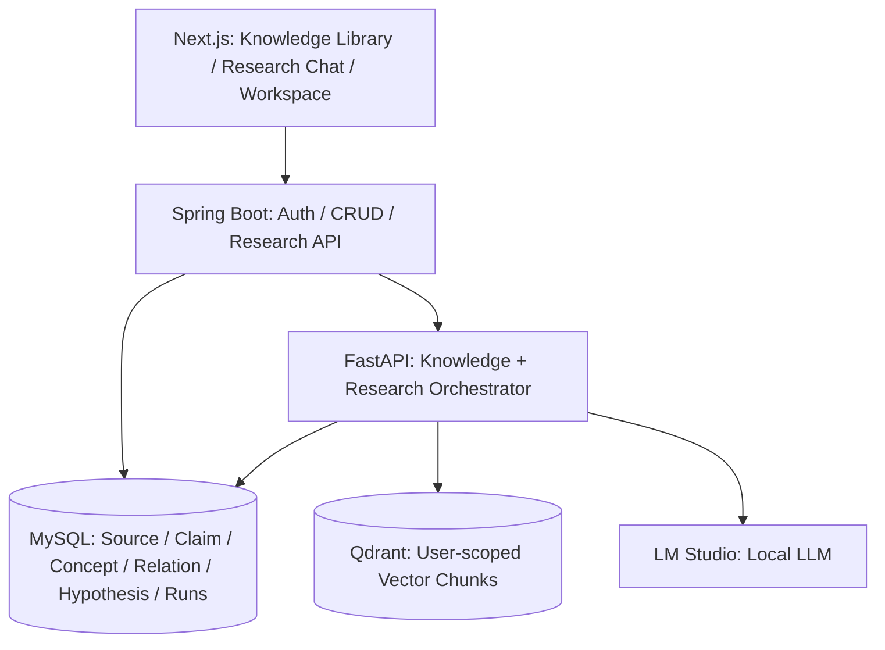
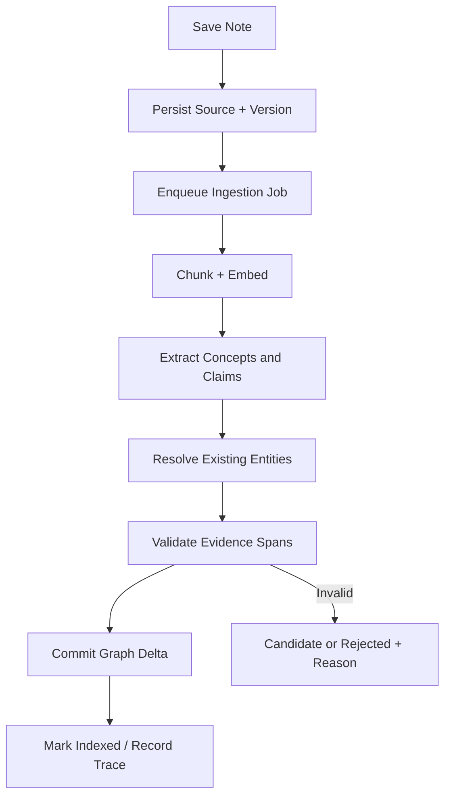
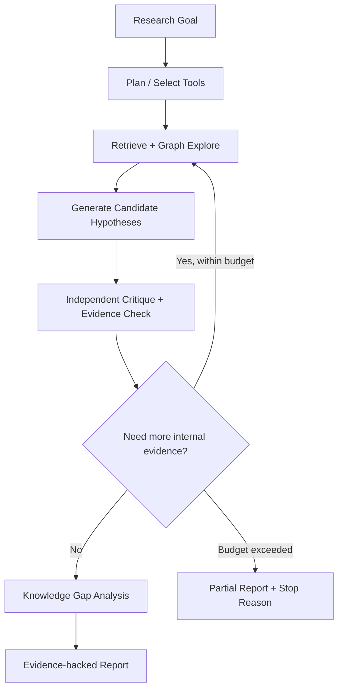

# Knowledge Hub 2.0 — 아키텍처와 데이터 계약

- 상태: 설계 제안, 실제 적용 전 검증 필요
- 선행: [요구사항](./REQUIREMENTS.md)

## 1. 설계 결정

기존 Next.js / Spring Boot / FastAPI / MySQL / Qdrant / BGE-M3 / LM Studio 구성을 우선 활용한다.

초기 그래프는 MySQL의 노드/관계 테이블로 구현한다. 그래프 DB(예: Neo4j)는 깊은 다중 홉 탐색이 실제 병목으로 측정될 때 검토한다. 'GraphRAG'는 그래프 검색과 벡터 검색의 결합을 뜻하며 특정 라이브러리 채택을 전제하지 않는다.

초기에는 다중 독립 에이전트를 만들지 않는다. 단일 **Research Orchestrator**가 기능별 도구를 선택, 재호출, 중단하고 하네스가 예산/권한/상태를 통제한다.

## 2. 논리 아키텍처



백엔드 책임을 분리한다:
- Spring Boot: 인증, 사용자 권한, 원본 문서 CRUD, 작업 상태 조회, 공식 데이터 계약.
- FastAPI: LLM 호출, 벡터/그래프 검색 전략, 구조화 추출, 인사이트 생성, 근거 검증.
- MySQL: 원본의 단일 진실 공급원, 노드/관계 및 연구 상태 영속화.
- Qdrant: 검색을 위한 파생 인덱스. 소실 시 원문에서 재생성할 수 있어야 한다.

FastAPI가 MySQL에 직접 접근하는 방식과 Spring 내부 API를 경유하는 방식 중 하나를 선택해야 한다. 초기 권장안은 Spring이 소유권을 판단하고 FastAPI에 신뢰 가능한 서버 간 컨텍스트를 전달하며, 그래프 저장은 명확한 단일 저장 계층에서 처리하는 것이다. 서로 다른 서비스가 동일 행을 무규칙하게 수정하지 않는다.

## 3. 핵심 엔터티 (초안)

| 엔터티 | 최소 컬럼/필드 | 주의점 |
| --- | --- | --- |
| knowledge_sources | id, owner_id, title, source_kind, citation_metadata, version, content, status, timestamps | 사용자가 작성한 노트가 실제 근거 |
| knowledge_chunks | id, source_id, source_version, span, content_hash, indexing_status | 벡터 payload에도 owner_id 포함 |
| knowledge_concepts | id, owner_id, canonical_label, aliases, definition, status | 같은 용어라도 문맥 다르면 분리 |
| knowledge_claims | id, owner_id, source_id, version, excerpt, normalized_claim, qualifiers, status | 원문에서 확인 가능한 위치 필수 |
| knowledge_relations | id, owner_id, subject_id, predicate, object_id, evidence_claim_ids, status, confidence | 근거 없는 확정 관계 금지 |
| research_runs | id, owner_id, goal, status, tool_trace, budget, timestamps | 중단 및 재개 고려 |
| research_hypotheses | id, run_id, owner_id, statement, testable_prediction, assumptions, status | claim과 분리 |
| hypothesis_evidence | hypothesis_id, claim_id, stance, rationale | support / challenge / context |
| knowledge_gaps | id, hypothesis_id, missing_information, reason, recommended_study, status | 구체적 가설/전제에 연결 |
| ingestion_jobs | id, source_id, source_version, status, attempts, error_code, timestamps | 증분 갱신과 실패 복구 |

실제 스키마 도입 전 기존 `posts`, `documents`, `categories`와의 관계 및 마이그레이션 절차 확정. 기존 게시글을 대량 삭제하거나 테이블을 즉시 이름 변경하지 않는다.

## 4. 파생 데이터 규칙

- 영속 원문 ID, 노트 버전, 인용 구간, 추출 모델/프롬프트 버전을 모든 claim/edge에 남긴다.
- 벡터 청크의 owner_id는 인증된 서버 컨텍스트에서만 부여한다.
- 동일 원문 버전에 대한 중복 이벤트는 같은 결과를 유지하도록 upsert 키/멱등 키 사용.
- 노트 수정 시 기존 버전의 파생 지식을 stale로 바꾸고 새 버전 추출이 완료된 후 활성화.
- 노트 삭제 시 관련 인용을 지우기 전에 연결된 가설의 근거 상실을 표시한다.
- 관계에 저장하는 confidence는 검증된 확률이라는 뜻이 아니다. 평가 데이터로 보정하지 않았다면 단순 내부 점수로 표현한다.

## 5. 지식 수집 파이프라인



추출 결과 예시 (개념/주장은 분리 저장):
```json
{
  "source_id": 123,
  "source_version": 2,
  "concepts": [
    {"temporary_id": "c1", "label": "Self-Attention", "aliases": [], "excerpt_span": [14, 68]}
  ],
  "claims": [
    {"temporary_id": "p1", "text": "사용자 요약에 명시된 주장", "excerpt_span": [90, 124], "qualifiers": []}
  ],
  "relations": [
    {"subject_ref": "c1", "predicate": "USES", "object_ref": "c2", "evidence_claim_refs": ["p1"]}
  ]
}
```

위 JSON은 계약의 개념 예시이며 모든 참조 대상의 실재와 범위 검사를 통과해야 반영된다.

## 6. 질의응답 및 연구 도구 계약

초기 도구:
- `search_knowledge(query, owner_scope, top_k)`: 내부 노트 청크 검색.
- `explore_graph(seeds, relation_types, depth, owner_scope)`: 관련 개념/주장 탐색.
- `inspect_source(source_id, source_version, spans, owner_scope)`: 근거 원문 재확인.
- `compare_claims(claim_ids)`: 지지, 충돌, 적용 조건 비교.
- `propose_hypotheses(evidence_ids, goal)`: 명시적 가설 후보 생성.
- `critique_hypotheses(hypothesis_ids, evidence_ids)`: 전제, 반론, 실패 조건 검토.
- `identify_gaps(hypothesis_id, unresolved_assumptions)`: 부족한 정보와 학습 방향.
- `persist_research_run(run_id, artifacts)`: 결과 및 실행 기록 저장.

**중요**: 도구 인자로 owner_id를 전달하더라도 권한 판단은 서버 측 보안 컨텍스트로 재확인한다. LLM이 반환한 소유자 ID, SQL, 임의 URL은 신뢰하지 않는다. 모델에 SQL 실행 권한이나 인터넷 연결 도구를 부여하지 않는다.

## 7. 자율 연구 하네스



보장해야 할 것:
1. 제한된 반복 횟수, 도구 호출 수 및 시간 예산.
2. 실패 사유, 호출 파라미터 요약, 입력/출력 참조 및 중단 이유 기록.
3. 구조화 출력 파싱 실패 시 제한된 재시도, 계속 실패하면 부분 결과/실패 반환.
4. LLM의 가설 생성 권한과 사용자 원문 수정 권한 분리.
5. 출처 없는 사실 주장, 없는 인용번호, 과도한 연구 신규성 선언을 차단.
6. 초기 연구 실행에서는 외부 도구 호출 금지.

## 8. 기존 코드 변경 지도

| 기존 파일 | 변경 계획 |
| --- | --- |
| `backend-spring/.../service/PostService.java` | `authorId=1L` 제거, 권한·버전 관리 및 색인 이벤트 |
| `backend-spring/.../config/SecurityConfig.java` | 개인 RAG API에 인증 요구, 사용자별 접근 제어 |
| `docker/mysql/init.sql` | 신규 환경 기본 스키마만 유지, 실제 변경은 별도 마이그레이션 도입 |
| `rag-fastapi/app/services/vector_store.py` | 사용자 스코프/노트 버전 필터, Qdrant 오류 시 fail-closed |
| `rag-fastapi/app/services/rag_service.py` | 가짜 임베딩 Fallback 금지, Q&A 유지, Research 실행 경로 분리 |
| `rag-fastapi/app/services/evidence_retriever.py` | 복수 청크 및 검색 전략 적응 |
| `rag-fastapi/app/services/query_planner.py` | 연구 의도 및 하위 질문 계획 |
| `rag-fastapi/app/services/claim_judge.py` | claim/evidence 대조 확장 |
| `rag-fastapi/app/services/novelty_judge.py` | 고정 판정 제거, 검증 전 신규성 주장 금지 |
| `rag-fastapi/app/models/schemas.py` | 신규 요청/응답 및 근거 계약 |
| `frontend-nextjs/components/AiKnowledgeChat.tsx` | 인증, Research Chat, 가설/근거 뷰 |
| `frontend-nextjs/app/write/page.tsx` | 출처 메타데이터 및 학습 노트 작성 |
| `frontend-nextjs/app/page.tsx` | Knowledge Library 진입, 기존 게시글 유지하며 점진 개편 |

## 9. 확장 보류 판단

다음은 성능/운영 요구가 확인될 때만 도입:
- Neo4j: 복잡한 다중 홉 쿼리 성능이 MySQL에서 부족하다고 측정된 경우.
- LangGraph: 체크포인트, 복구, 실행 분기 관리가 자체 하네스보다 실질적으로 낫다는 검증이 있는 경우.
- 멀티에이전트: 단일 오케스트레이터보다 품질이 높고 비용/지연을 감수할 가치가 있다는 비교 실험이 있는 경우.
